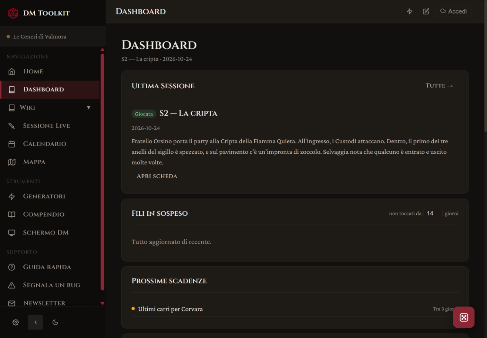
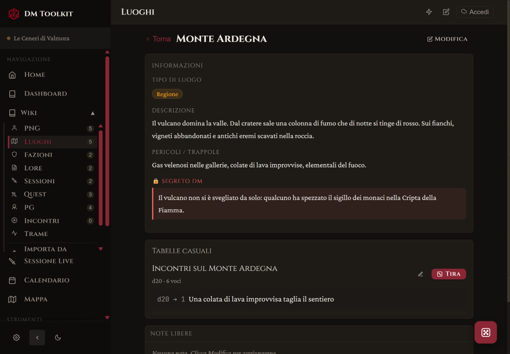
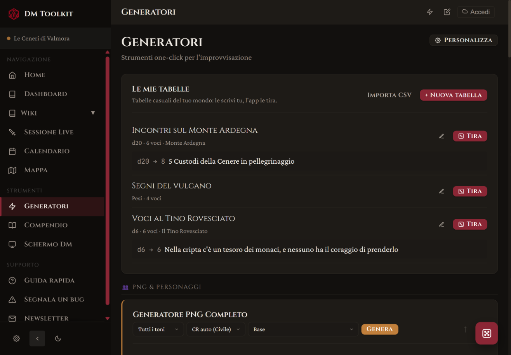
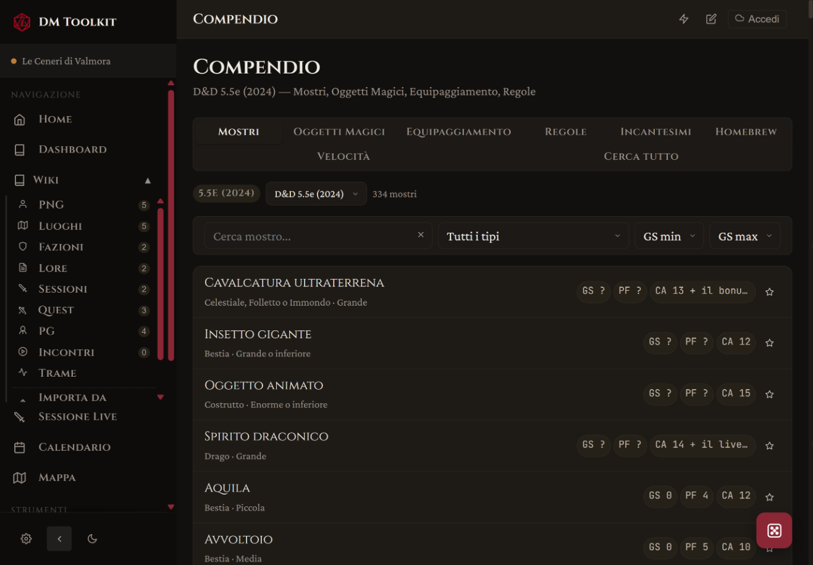
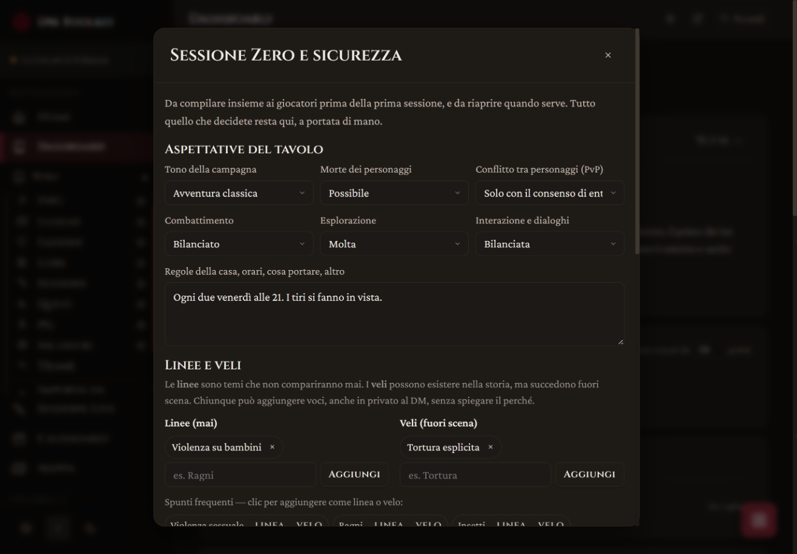

# DM Toolkit

[](https://gdr-sys.github.io/dm-toolkit/)
[](https://gdr-sys.github.io/dm-toolkit/)
[](https://gdr-sys.github.io/dm-toolkit/)
[](https://firebase.google.com/)
[](https://www.dndbeyond.com/srd)

Web app per Dungeon Master di D&D 5e (edizioni 2014 e 2024) per gestire una campagna dalla preparazione della sessione al combattimento al tavolo, da qualsiasi dispositivo e senza installare nulla.



Per vederla in azione: apri l'app e, nella Home vuota, scegli **"Prova con una campagna di esempio"**. Si crea *Le Ceneri di Valmora*, già piena di PNG, luoghi, sessioni, tabelle e calendario.

---

## In breve

| Area | Cosa offre |
|---|---|
| Wiki | Editor completo, [[collegamenti]], @menzioni, tag, grafo, modelli, import da foglio di calcolo |
| Mondo | PNG, Luoghi, Fazioni, Quest, PG, Trame, Incontri |
| Mappe | Mappe interattive con segnaposto, mappe annidate, misura distanze, zoom con due dita |
| Calendario | Calendario in-world personalizzabile, eventi, scadenze, timeline |
| Sessioni | Combat tracker, scene planner, diario delle sessioni, clock |
| Generatori | 22 generatori pronti + **le tue tabelle casuali** |
| Compendio | SRD 5.1 e 5.2.1, homebrew |
| Schermo del DM | Blocchi personalizzabili, trascinabili |
| Sincronizzazione | Google Drive per i dati, Firebase come segnale in tempo reale |
| App installabile | Su PC, tablet e telefono, funziona anche offline |

---

## Funzionalità

### Wiki

Editor con barra di formattazione (titoli, grassetto, corsivo, colori, evidenziatore) e riquadri speciali: Da leggere ad alta voce, Segreto DM, Bottino, Indizio, Trappola, Idea al volo. Le note supportano:

- **Collegamenti** — `[[Nome PNG]]`, `[[location:Castello]]`, `[[faction:Gilda]]`, con navigazione diretta all'elemento collegato
- **@menzioni** — scrivi `@` in qualsiasi editor per scegliere un elemento della campagna, o crearne uno nuovo al volo
- **Tag** — `#tag` colorati, con barra e filtro
- **Collegamenti inversi** — ogni nota sa chi la cita
- **Grafo** — tutti i collegamenti tra gli elementi della campagna, cliccabili
- **Modelli** — Sessione, Lore, PNG, Luogo, Oggetto magico, Dungeon/Stanza, Evento/Segreto, Negozio, più i tuoi
- **Import da foglio di calcolo** — PNG, luoghi e altro da CSV (compatibile con Excel in italiano)
- **Cestino** — le voci eliminate si possono recuperare

La ricerca globale `Ctrl+K` cerca in note, PNG, luoghi, fazioni e Compendio, anche nel contenuto dei campi.

### Mondo

PNG, Luoghi, Fazioni, Quest, PG, Trame e Incontri hanno ciascuno la propria sezione nella Wiki, con campi dedicati (per esempio ruolo, obiettivi, segreto DM, attitudine della fazione verso il party) e date in-world di nascita, fondazione o creazione.

- **Ritratti** da link o caricati dal dispositivo. Con Google Drive collegato finiscono sul tuo Drive. Si possono incollare anche i link di condivisione di Drive: l'app li trasforma da sola nell'immagine, e se non si vede spiega il perché (per esempio se il file non è condiviso con "Chiunque abbia il link").
- **Statistiche complete** per PNG e PG: caratteristiche, CA, PF, tiri salvezza, azioni.
- **Momenti dei personaggi** — cronologia degli eventi importanti di ogni PNG e PG.
- **Reputazione con le fazioni** — una scala da Nemica giurata a Devota, con la cronologia di cosa l'ha fatta cambiare e quando (anche in data in-world).
- Rinominare un elemento aggiorna tutti i `[[collegamenti]]` nelle note.
- **"Entra in scena"** — nella scheda di un luogo, un pulsante compone la scena con quello che hai già scritto: i PNG che stanno lì, le quest in gioco, il tempo secondo la stagione del calendario, rumori e odori, un evento in corso, una voce di corridoio con schede vere e un tiro su ogni tabella collegata. Si può rigenerare, copiare o aggiungere alle note della sessione.
- **Segreti e indizi** — ogni segreto ha i suoi indizi, e ogni indizio sta in un PNG, un luogo o una quest, con la condizione per ottenerlo (per esempio "Persuasione CD 14"). La scheda di un PNG mostra **cosa sa** e come farselo dire; la Dashboard mostra i segreti non ancora rivelati e avvisa quando un segreto ha meno di tre indizi.
- **Importa da un'altra campagna** — copia luoghi, fazioni, PNG, note Lore e tabelle da un'altra campagna, per una one shot o un secondo gruppo nello stesso mondo.
- Una nota creata da un modello PNG o Luogo crea anche l'elemento corrispondente e resta collegata. Salvare un elemento invece **non** crea più note doppie nella Lore.



### Mappe

Carica un'immagine come mappa interattiva. Puoi spostarla trascinando e ingrandirla con la rotella o, su tablet e telefono, **con due dita**.

- **Segnaposto** collegabili a PNG, luoghi, fazioni o note; le coordinate sono in percentuale, quindi restano giuste su ogni schermo.
- **Mappe annidate** — un segnaposto può aprire un'altra mappa (regione → città → taverna), con il pulsante per tornare indietro.
- **Misura distanze** tra due segnaposto, in base alla scala della mappa.

### Calendario e Timeline


- Calendario in-world con preset (Forgotten Realms, Greyhawk…) o **completamente personalizzato**: mesi, giorni della settimana, festività, data e ora di oggi.
- **Eventi e scadenze** con promemoria; le scadenze vicine compaiono nella Dashboard.
- **Conseguenze programmate** — una scadenza può dire cosa succede se il party non interviene: prima della data compare come "Se scade…", dopo come "È successo…". Anche un clock pieno mostra la sua conseguenza.
- **Timeline** di eventi e sessioni: gli eventi vicini nel tempo vanno su righe diverse, così i nomi non si sovrappongono mai. Lo zoom allarga solo il tempo, le scritte restano leggibili.

### Sessioni

- **Combat tracker** — iniziativa, PF, CA, condizioni, concentrazione con CD automatica, effetti con conto alla rovescia dei round, riposi brevi e lunghi.
- **Schermo sempre acceso** — su tablet e telefono lo schermo non si spegne durante uno scontro (oppure sempre, o mai: si sceglie nelle Impostazioni).
- **Scene planner** — la sequenza di momenti di ogni sessione (apertura, combattimento, sociale, esplorazione, rivelazione, cliffhanger…), riordinabile.
- **Diario delle sessioni** — numero, titolo, date reale e in-world, stato, PNG coinvolti, preparazione e riassunto. Ogni sessione può avere la sua nota nella Wiki.
- **Chiudi la sessione in 5 domande** — cosa è successo, XP e bottino, fili rimasti aperti, gancio per la prossima volta, momento migliore. Dalle risposte l'app compila da sola il diario della sessione, i ganci in Dashboard, la prossima sessione pianificata, un Momento del PG e il "Previously On…".
- **"Previously On…"** — il riassunto dell'ultima sessione, pronto da leggere al tavolo.
- **Party** — i PG con classe, livello, PF, CA, punteggi passivi e ispirazione, sincronizzati con la sezione PG della Wiki.
- **Clock** — per rituali, inseguimenti, pressione delle fazioni.

### Generatori




22 generatori per improvvisare: PNG completo, meteo, rumori e odori, descrizione di luoghi, nomi di luoghi, negozio (con i prezzi degli oggetti magici), biblioteca, bottino, viaggio, incontri, incontro bilanciato, voci di corridoio, accenti, nomi, follia, ganci, oracolo, missioni. Tutti, comprese "Le mie tabelle", si possono nascondere da **Personalizza** e riordinare. Il **Generatore Nomi** non propone nomi già usati dai tuoi PNG, e le **Voci di corridoio** aggiungono due voci costruite con PNG, luoghi e fazioni della tua campagna, cliccabili.

- **Trappole ed enigmi** — trappole con innesco, CD e danni adatti al livello del party e alla pericolosità scelta, come accorgersene e disinnescarle; enigmi con suggerimento e soluzione; indovinelli con risposta. Soluzioni e risposte restano nascoste finché non le apri.
- **Dungeon e stanze** — una stanza alla volta per tema (rovina, cripta, caverna, fortezza, tempio, tana di mostri) con dimensioni, sensazioni, uscite, contenuto e complicazioni, oppure un intero **dungeon in cinque stanze**.
- **Taverne e insediamenti** — taverne con oste, clientela, specialità, voci e problemi; villaggi, paesi e città con popolazione, chi comanda, PNG chiave e problema del momento. Un clic e diventano un Luogo della tua campagna.
- **Eventi di viaggio e riposo** — cosa succede lungo la strada o al campo, per ambiente (foresta, montagna, palude, deserto, pianura, costa, sotterraneo, città).

**Le mie tabelle** — le tabelle casuali del tuo mondo: le scrivi tu, l'app le tira.

- Dado d4, d6, d8, d10, d12, d20, d100 oppure **pesi liberi**.
- Una voce per riga: con l'intervallo davanti (`1-3 Goblin`), solo il testo (le voci si dividono il dado), o con il peso (`3 Goblin`, esce tre volte più spesso).
- Dentro una voce, `{2d6+1}` tira dei dadi e `[[Altra tabella]]` tira su un'altra delle tue tabelle.
- L'anteprima mostra gli intervalli e avvisa di numeri scoperti, doppi o tabelle richiamate che non esistono.
- **Import da CSV** (anche da Excel), sempre rivisto prima di salvare.
- **Collegabili ai Luoghi**: "Incontri nella Foresta di Velmor" compare nella scheda della foresta, con il suo pulsante Tira.

### Compendio




Mostri SRD 5.1 e 5.2.1 con GS normalizzato (comprese le frazioni 1/8, 1/4, 1/2), oggetti magici, equipaggiamento, incantesimi, regole, velocità di cavalcature e veicoli. Homebrew integrato: le note Wiki con tag `#oggetto` o `#mostro` finiscono nel Compendio. Preferiti per campagna, ricerca, filtri per tipo e GS. Su schermi larghi l'elenco va su più colonne.

### Sessione Zero e sicurezza



- **Aspettative del tavolo** — tono, morte dei personaggi, conflitto tra PG, quanto combattimento, esplorazione e dialoghi, regole della casa.
- **Linee e veli** — cosa non comparirà mai e cosa resterà fuori scena, con gli spunti più comuni da aggiungere in un clic.
- **Strumenti al tavolo** — carta X, porta aperta, pausa, stelle e desideri, ciascuno spiegato.
- **Carta X a schermo intero** dalla Dashboard, da mostrare al tavolo con un tocco.

### Schermo del DM

Griglia di blocchi trascinabili e ridimensionabili: percezioni passive del party, dadi rapidi, meteo, condizioni, mini combat tracker, calcolatore di incontri (2014/2024), data e ora in-world, note libere. Con il blocco **"Generatore o tabella"** puoi mettere sullo schermo qualsiasi generatore o una delle tue tabelle, con il suo pulsante.

### Dashboard e strumenti

- **Primi passi** — in una campagna nuova, cinque cose da fare per partire (Sessione Zero, primo PNG, primo luogo, prima sessione, un generatore) che si spuntano da sole.

- **Fili in sospeso** — PNG, luoghi, fazioni, quest e trame non toccati da un po', per non perdere i ganci.
- **Prossime scadenze** dal calendario.
- **Scheda rapida PNG** dalla barra in alto, per consultare un PNG a metà sessione.
- **Blocco note** sempre a portata di mano.
- **Lanciadadi** sempre a portata di mano, con formule (`4d6kh3`, `2d8+5`) e il registro degli ultimi 50 tiri, con l'ora e i singoli dadi.
- Backup e ripristino in JSON, per campagna o completo, e backup automatico su Google Drive.

---

## Sincronizzazione e collaborazione

Tre modalità, scelte al primo accesso:

```
Solo locale    ->  dati solo su questo dispositivo, nessun account
Anonimo        ->  Firebase, dati sul cloud senza credenziali
Google / Email ->  Firebase, più dispositivi e co-autori in tempo reale
```

Un account anonimo si può trasformare in account Google in qualsiasi momento senza perdere dati.

**Google Drive come archivio principale.** Con Drive collegato, i dati veri della campagna e le immagini stanno sul tuo Drive, in un file per campagna nella cartella "DM Toolkit". Firebase conserva solo un piccolo riferimento per campagna, usato come segnale istantaneo "qualcosa è cambiato" per aggiornare gli altri dispositivi.

- I dati restano privati nel tuo Drive. Il Client ID OAuth dell'app è condiviso e serve solo a identificare l'app presso Google: basta cliccare "Collega Drive" e scegliere il proprio account.
- **Su un dispositivo nuovo** le campagne si scaricano da sole appena colleghi Drive, anche se lo colleghi dopo aver fatto l'accesso.
- Ogni campagna ha **un solo file** su Drive, anche usandola da più dispositivi, e ogni immagine viene caricata **una volta sola**.
- **Ripristina da Drive** elenca i backup con data e peso, così si riconoscono subito quelli vuoti.
- Senza Drive collegato, Firebase porta i dati della campagna, ma **mai le immagini e i file pesanti**: quelli restano sul dispositivo e passano su Drive appena lo colleghi. Così Firebase resta leggero e dentro la quota gratuita.

**Collaborazione in tempo reale.** Ogni campagna ha un codice invito: un co-autore lo inserisce e accede alla stessa campagna. Le modifiche partono 2 secondi dopo ogni cambiamento; le modifiche dei due lati vengono unite voce per voce, senza sovrascriversi. Cancellare una campagna vale per tutti i dispositivi, anche quelli offline in quel momento. La presenza online è mostrata nella barra in alto.

---

## App installabile e offline

DM Toolkit si installa come un'app: "Installa app" in Chrome o Edge su PC, "Aggiungi alla schermata Home" su iPad, iPhone e Android.

- **Funziona offline** in tutte le sue parti: al primo avvio con internet scarica dati, Compendio, generatori, font e librerie. Le immagini delle mappe già viste si vedono anche senza connessione. Le modifiche fatte offline si sincronizzano al ritorno della rete.
- **Aggiornamenti** — all'apertura arriva sempre la versione più recente. Se l'app resta aperta a lungo (succede spesso su tablet) e nel frattempo esce un aggiornamento, compare un banner "È disponibile una nuova versione" con il pulsante Aggiorna, che prima aspetta la fine dei salvataggi in corso.
- Le pagine si adattano alla larghezza dello schermo, dal telefono al monitor grande.

---

## Tecnologie

Il cuore dell'app è un unico file HTML: niente framework, niente bundler, nessuna dipendenza NPM. Alcune funzioni autonome stanno in file separati nella cartella `js/`, caricati con normali tag `<script src>`, così il file principale non deve crescere a ogni aggiunta.

| Libreria | Uso | Caricamento |
|---|---|---|
| Firebase 10 compat | Accesso + Realtime Database | CDN (opzionale) |
| d3 v7 | Grafo della Wiki, timeline | CDN |
| SortableJS 1.15 | Trascinamento nello Schermo del DM | CDN |

---

## Licenza

I dati di gioco provengono dal System Reference Document (SRD) di D&D 5e, pubblicato da Wizards of the Coast con licenze OGL e ORC.
